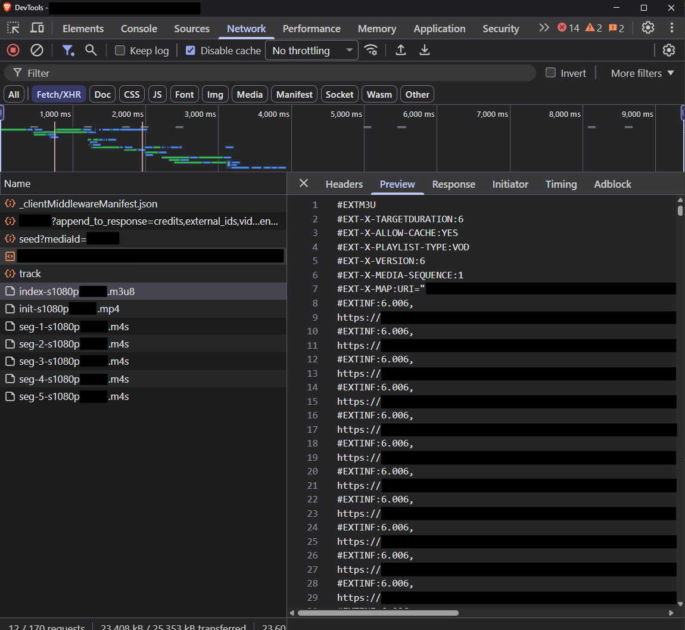

# Downloading HLS Streams with DevTools and `ffmpeg`

How to download HLS streams with DevTools and `ffmpeg` on a Windows device.

<!-- more -->

## Overview

* Website HTML pages used to reference the video source file directly, e.g. `src="/media/videos/hello-world.mp4"`
* That means when users load the video source file, they are loading the `hello-world.mp4`.
* If the connection is slower than the file's bitrate, playback stalls while it catches up.
* To improve streaming, the MP4 is broken down into pieces, and each piece is sent one at a time.
* One of the most widely adopted methods of doing this is HLS (HTTP Live Streaming).

## HLS Streams

It was originally developed by Apple for iOS/Safari, and it is now supported almost everywhere.

Core structure:

```txt
master.m3u8              -> top-level manifest listing the available qualities
  ├── index-1080p.m3u8   -> variant playlist: segment list for one quality
  ├── index-720p.m3u8
  └── index-480p.m3u8
```

An example `master.m3u8`:

```txt
#EXTM3U
#EXT-X-STREAM-INF:PROGRAM-ID=1,BANDWIDTH=6126617,RESOLUTION=1996x1080,FRAME-RATE=23.974,CODECS="avc1.64002a,mp4a.40.2"
media-id/1/index-s1080p.m3u8
#EXT-X-STREAM-INF:PROGRAM-ID=1,BANDWIDTH=16160812,RESOLUTION=3840x2076,FRAME-RATE=23.974,CODECS="avc1.640033,mp4a.40.2"
media-id/1/index-s2160p.m3u8
#EXT-X-STREAM-INF:PROGRAM-ID=1,BANDWIDTH=1306696,RESOLUTION=852x480,FRAME-RATE=23.974,CODECS="avc1.4d401e,mp4a.40.2"
media-id/1/index-s480p.m3u8
#EXT-X-STREAM-INF:PROGRAM-ID=1,BANDWIDTH=3140557,RESOLUTION=1332x720,FRAME-RATE=23.974,CODECS="avc1.4d4020,mp4a.40.2"
media-id/1/index-s720p.m3u8
```

Each variant playlist lists the segments. Traditionally these are `.ts` files; modern HLS also uses fMP4 `.m4s` fragments. The playlist carries an `#EXT-X-MAP` tag for the init segment reference and an `#EXTINF` tag for each duration:

```txt
#EXTM3U
#EXT-X-TARGETDURATION:6
#EXT-X-ALLOW-CACHE:YES
#EXT-X-PLAYLIST-TYPE:VOD
#EXT-X-VERSION:6
#EXT-X-MEDIA-SEQUENCE:1
#EXT-X-MAP:URI="https://example.com/init-s1080p.mp4"

#EXTINF:6.006,
https://example.com/seg-1-s1080p.m4s
#EXTINF:6.006,
https://example.com/seg-2-s1080p.m4s
#EXTINF:6.006,
https://example.com/seg-3-s1080p.m4s
#EXTINF:6.006,
https://example.com/seg-4-s1080p.m4s
#EXTINF:6.006,
https://example.com/seg-5-s1080p.m4s
#EXT-X-ENDLIST
```

Key characteristics:

* Plain-text `.m3u8` playlists (derived from the M3U audio playlist format)
* Historically used MPEG-TS segments (`.ts`); modern HLS supports fMP4 (`.m4s`) too
* Native playback support in Safari/iOS (no JS library needed) — this is why it's still dominant in Apple's ecosystem
* Everywhere else (Chrome, Firefox, Android), it needs a JS library such as hls.js, which uses MSE. This is why you see it under Fetch/XHR
* Live streaming: the playlist gets new `#EXTINF` lines appended as segments are encoded, with no `#EXT-X-ENDLIST` until the stream ends
* VOD: the playlist is complete upfront and ends with `#EXT-X-ENDLIST`

## Steps

### Disable Abusive Debugger Statements

Reference: [Disable Abusive Debugger Statements](https://devtoolstips.org/tips/en/disable-abusive-debugger-statement/)

<video controls width="100%" src="/videos/disable-abusive-debugger-statement.mp4"></video>

1. Before going to the target website, visit a site that lets you open the F12 developer tools.
2. Press F12 to bring up the Developer Tools.
3. Proceed to the target website.
4. The developer tools will stop at the "Sources" tab and show the "debugger" line.
5. Go to the line with `debugger` and right-click beside the line number.
6. Choose the option "Add conditional breakpoint…".
7. Type `false` and press Enter.
8. Reload the page.
9. You can now inspect the web page.

### Getting the `*index*.m3u8` Link

There are multiple ways to get the `*index*.m3u8` link, i.e. the link that shows the details of the segmented video files. The master playlist, which lists the resolutions of the videos, does not always exist.

#### 1. Search for m3u8

1. From the developer tools (F12), go to the Network tab and search using the keyword `m3u8`.
2. There should be a link whose URL ends with `m3u8`.
3. Select the link matching `*index*.m3u8` and copy its URL.

#### 2. Filter by "Fetch/XHR"

1. From the developer tools (F12), go to the Network tab.
2. Click the "Fetch/XHR" filter.
3. You will see a single `.m3u8` file, a `.mp4` file, and a couple of `.m4s` files.

    

4. Select the link matching `*index*.m3u8` and copy its URL.

#### 3. Observe the Network

!!! info

    Method 1 relies on the request name containing `m3u8`. Method 2 will usually surface the request, but you still have to recognise it by name. Reading the response body works either way.

1. Open the developer tools (F12) and go to the Network tab.
2. Refresh the page so that we can see the new links as they come in.
3. If there is no `.m3u8` link, click on each link and read the `Response` tab.
4. The response should show plain text with `#EXTM3U` as the first line (as shown earlier).
5. Select the link matching `*index*.m3u8` and copy its URL.

### Getting the Media

There are two ways I have tried to download the media.

1. Use ffmpeg to download the media file.

    ```powershell
    ffmpeg -i https://example.com/media-id/1/index-s1080p.m3u8 -c copy saveasvid.mp4
    ```

    !!! info

        Some sites reject `ffmpeg` because its request headers do not look like a browser's. Copy the headers from the Network tab and pass them in (PowerShell):

        ```powershell
        ffmpeg -headers "Referer: https://example.com/`r`nUser-Agent: Mozilla/5.0 (Windows NT 10.0; Win64; x64)`r`nCookie: session=abc123`r`n" -i "https://example.com/media-id/1/index-s1080p.m3u8" -c copy saveasvid.mp4
        ```

        I have not needed this myself, so treat it as untested. It also will not help if the token is only on the `.m3u8` URL, because `ffmpeg` does not add it to the segment requests.

2. Create a script to download each segment (`*.m4s`, `*.ts`, and others such as `*.png` and `*.html`), **including the `*init*.mp4`, which stores the information about the media file**. Then create a second script that combines the segments and uses `ffmpeg` to produce a finished `.mp4`. The following snippet stitches the segments together, in order, into a temporary `temp_output.mp4`, then calls `ffmpeg` to create the final `combined.mp4`.

    ```py
    """
    The snippet only works if the downloaded segments are named
    - `init.mp4`
    - `seg-*.m4s`
    Standardising them helps ensure the script works consistently.
    """
    import sys
    import pathlib
    import shutil
    import re
    import subprocess

    # sort the files by segment number
    def _seg_key(p: pathlib.Path) -> int:
        """helper function to sort the file names by the numbers in the segment files"""
        m: re.Match = re.search(r'seg-(\d+)', p.name)
        return int(m.group(1)) if m else -1 # init.mp4 -> -1, so first
    
    # define the temporary folder that holds all the segment files
    temp_dir: pathlib.Path = pathlib.Path(__file__).parent / "temp"

    # define the temporary .mp4 file after stitching each segment
    temp_output_path: pathlib.Path = pathlib.Path(__file__).parent / "temp_output.mp4"

    # write each file to the 'temp_output.mp4' file
    with temp_output_path.open("wb") as writer:
        for file in sorted(temp_dir.glob("*.*"), key=_seg_key):
            with file.open("rb") as f:
                shutil.copyfileobj(f, writer, length=1024*1024)
    
    # run the ffmpeg command here
    try:
        output_name: str = str(pathlib.Path(__file__).parent / "combined.mp4")
        # ffmpeg must be reachable from the terminal
        subprocess.run(
            args=["ffmpeg", "-y", "-i", str(temp_output_path), "-c", "copy", output_name],
            capture_output=False,
            text=False, # set text=True to get stdout/stderr as strings
            check=True, # raises an exception if the exe returns a non-zero exit code
        )
    except subprocess.CalledProcessError as e:
        print(f"ffmpeg failed with code {e.returncode}: {e}")
        sys.exit(1)
    except FileNotFoundError:
        print("ffmpeg not found on PATH")
        sys.exit(1)
    ```

## Sources

* [Disable Abusive Debugger Statement](https://devtoolstips.org/tips/en/disable-abusive-debugger-statement/)
* [FFmpeg Protocols — HLS](https://ffmpeg.org/ffmpeg-formats.html#hls-1)
* [RFC 8216 — HTTP Live Streaming](https://datatracker.ietf.org/doc/html/rfc8216)
